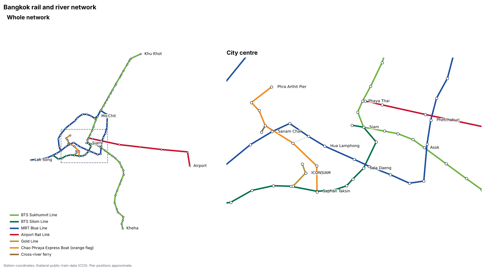
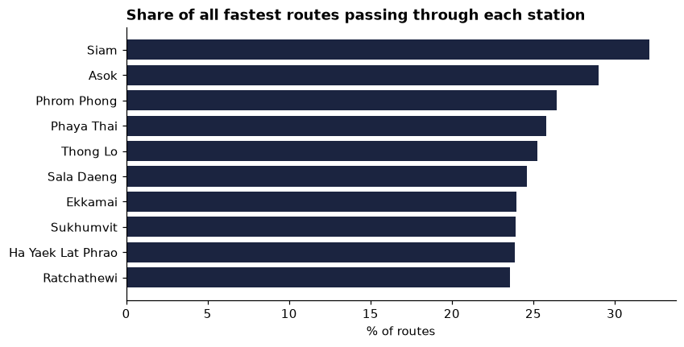
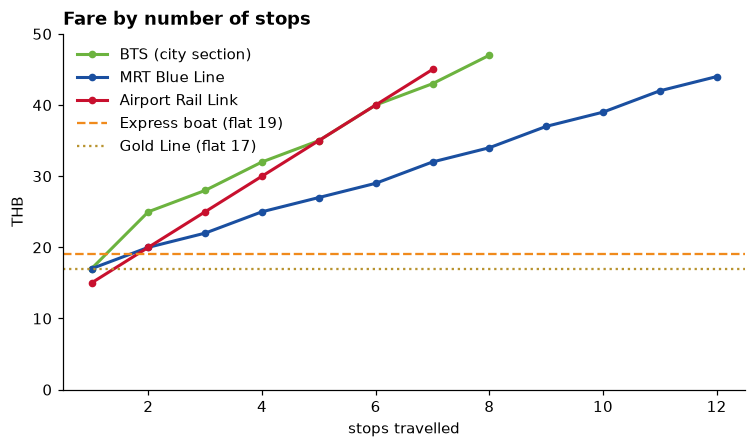
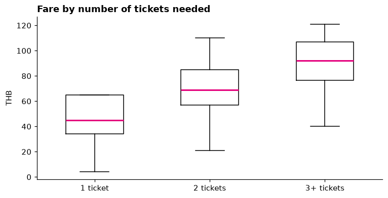
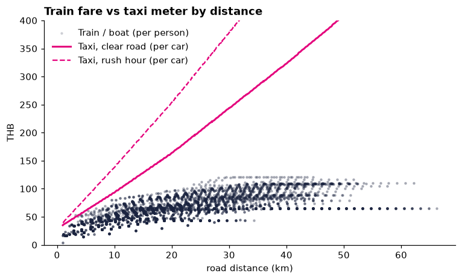

# Bangkok Transit Analysis

What Bangkok's rail and river network and its fares tell you, analysed with Python.
I computed the fastest route and fare between every pair of the 117 stations and piers (13,550 trips) on the BTS Skytrain, MRT Blue Line, Airport Rail Link, Gold Line and Chao Phraya boats.

The data and fare rules come from the route planner in my [Bangkok Guide website](https://tawansir1.github.io/bangkok-travel-guide/).

**Open [`analysis.ipynb`](analysis.ipynb) to read the full analysis with code and charts.**



## Findings

**Siam is the busiest junction, but the Sukhumvit branch is the weak point.**
A third of all fastest routes pass through Siam. Yet if the line is blocked at Asok, 27% of all trips become impossible, because the 19 stations east of it have no other link. Blocking Siam cuts off only National Stadium.



**The MRT is the cheapest per stop.** Five stops cost 27 THB on the MRT but 35 THB on the BTS or Airport Rail Link.



**Changing operator is expensive.** 53% of trips need two or more tickets. The median fare goes from 45 THB (one ticket) to 69 (two) and 92 (three or more). One ticket for the whole trip would cut the median multi-ticket fare from 70 to 44 THB.



**Alone, the train always wins.** A metered taxi is never cheaper for one person. With 3 people it is cheaper for 60% of trips on a clear road, but only 20% in rush hour.



## How it works
- `data/*.csv` hold the stations, links between them, fare tables, the taxi meter and station coordinates (`coords.csv`).
- `transit.py` builds the network and finds the fastest route with **Dijkstra's algorithm**. A search state is *(station, line you arrived on)*, so changing line adds platform waiting time. Each route is split into rides, one per ticket, and priced with that operator's fare table.
- `analysis.ipynb` uses **pandas** for the trip table, **networkx** for betweenness centrality and the network drawing, and **matplotlib** for charts.

## Run it
```bash
git clone https://github.com/tawansir1/bangkok-transit-analysis.git
cd bangkok-transit-analysis
python3 -m venv .venv
source .venv/bin/activate
pip install -r requirements.txt
jupyter notebook analysis.ipynb
```
Or open the folder in VS Code with the Python and Jupyter extensions.

Try one trip from Python:
```python
from transit import Network
net = Network.load("data")
trip = net.trip("E4", "BL29")        # Asok to Wat Mangkon
print(trip.fare, round(trip.minutes))  # 32 THB, about 26 min
```

## Limits
- Fares are adult single-journey prices checked in November 2026. BTS extension fares and the river ferry are estimates.
- Travel times assume 2.5 minutes per stop and a 4-minute wait each time you board.
- Taxi distance is estimated from rail distance (×1.2), not real roads, and ignores tolls.
- The Purple, Pink, Yellow and Red lines are not included yet.

## Credits
Station coordinates come from [thailand-public-train-data](https://github.com/Gusb3ll/thailand-public-train-data) (CC0). River pier positions are approximate.

## Author
Sirinut Gerdsomchuea (Tawan) — [GitHub](https://github.com/tawansir1)
